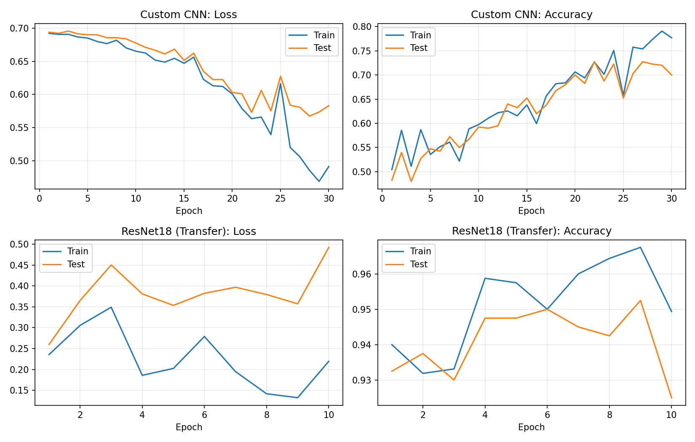
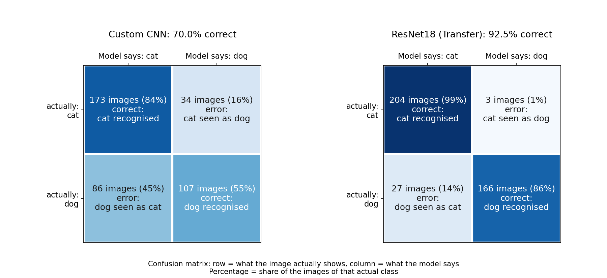

# Cat and Dog Classification: Custom CNN vs. Transfer Learning

Image classification (cat/dog) with PyTorch. I built a CNN from scratch and compared it with a pretrained ResNet18 to see how much transfer learning helps on a small dataset.

## Results

Test set: 400 images (20% of 2000), fixed split (seed 42).

| Model | Test Accuracy | Precision | Recall |
| --- | --- | --- | --- |
| Custom CNN (3x conv, trained from scratch) | approx. 70% | approx. 0.76 | approx. 0.55 |
| ResNet18 (pretrained, final layer only) | approx. 92.5% | approx. 0.98 | approx. 0.86 |

The exact values from the last run are in `results/results.md` (generated by `comparison.py`).
With 400 test images, accuracy is only precise to roughly +/-2 to 4 percentage points, so individual decimal places are not reliable.





## Method

- **Data:** 2000 images selected from the Kaggle Cats and Dogs dataset, stored in `data/cats_and_dogs_kaggle` and loaded with `ImageFolder` at 128x128 resolution.
- **Split:** 80/20 with `random_split` and a fixed seed so all runs are comparable.
- **Augmentation (training only):** random horizontal flip and rotation by up to 10 degrees. Test data remains unchanged so evaluation is not distorted. A small dataset class applies a separate transform to each split after splitting.
- **Custom CNN:** 3x (conv, ReLU, MaxPool 2x2) with 16/32/64 filters, followed by two linear layers. Trained with SGD (momentum 0.9), `CrossEntropyLoss`, for 30 epochs.
- **Transfer learning:** ResNet18 with ImageNet weights, frozen backbone, and only the new output layer (512 to 2) trained for 10 epochs. Inputs are normalized with the ImageNet values.
- **Metrics:** accuracy, precision, recall, and F1, calculated from TP/FP/TN/FN.
- **Checkpoints:** custom CNN training saves a checkpoint after every epoch (`cnn.py`).

## Findings

- The learning rate was crucial for the custom CNN: with 0.01, accuracy, precision, and recall varied considerably between epochs; with 0.005, training was more stable.
- Too much regularization at once (dropout 0.5, weight decay, strong augmentation, BatchNorm) slowed learning so much that the model stayed near 50%. Changes should therefore be tested one at a time.
- The custom CNN shows overfitting: test loss starts increasing around epoch 27 while training loss continues to decrease. This is expected with 1,600 training images and more than 1.6 million parameters in the first linear layer.
- Pretrained features help greatly with small datasets: ResNet18 performs much better than the custom CNN with only 1,026 trainable parameters.

## Run the project

```bash
pip install torch torchvision matplotlib
```

Download the dataset and arrange the selected images as one subfolder per class:

```text
data/cats_and_dogs/
├── cats/
└── dogs/
```

Source: [Cats and Dogs Dataset](https://www.kaggle.com/datasets/bhavikjikadara/dog-and-cat-classification-dataset)

```bash
python cnn.py                # custom CNN with checkpoints
python resnet_transfer.py   # ResNet18 transfer learning
python comparison.py        # train both models and create plots and table in results/
```

## Files

| File | Contents |
| --- | --- |
| `cnn.py` | custom CNN, training, testing, metrics, checkpoints |
| `resnet_transfer.py` | ResNet18 with transfer learning |
| `comparison.py` | comparison, curves, confusion matrix, misclassified images |
| `results/` | generated plots and results table |
