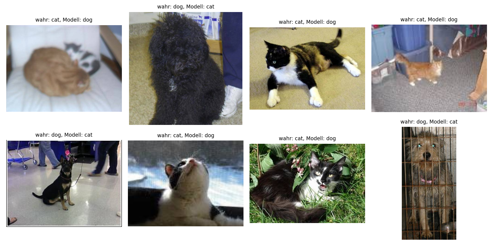

# Katzen und Hunde klassifizieren: eigenes CNN vs. Transfer Learning

Bildklassifikation (Katze/Hund) mit PyTorch. Ich habe ein CNN von Grund auf gebaut und es mit einem vortrainierten ResNet18 verglichen, um zu sehen, wie viel Transfer Learning bei einem kleinen Datensatz bringt.

## Ergebnisse

Test-Set: 400 Bilder (20 % von 2000), fester Split (Seed 42).

| Modell | Test-Accuracy | Precision | Recall |
|---|---|---|---|
| Eigenes CNN (3x Conv, Training von Grund auf) | ca. 72 % | ca. 0.77 | ca. 0.61 |
| ResNet18 (vortrainiert, nur letzter Layer trainiert) | ca. 94 % | ca. 0.95 | ca. 0.93 |

Die genauen Werte meines letzten Laufs stehen in `results/results.md` (erzeugt von `portfolio_results.py`).
Bei 400 Testbildern ist die Accuracy auf etwa ±2 bis 4 Prozentpunkte genau, einzelne Dezimalstellen sind daher nicht belastbar.




## Vorgehen

- **Daten:** `cats_and_dogs_filtered` (2000 Bilder), mit `ImageFolder` geladen, auf 128x128 skaliert.
- **Split:** 80/20 mit `random_split` und festem Seed, damit alle Läufe vergleichbar sind.
- **Augmentation (nur Training):** zufälliges horizontales Spiegeln und Rotation um bis zu 10 Grad. Die Testdaten bleiben unverändert, damit die Bewertung nicht verfälscht wird. Dafür wendet eine kleine Dataset-Klasse nach dem Split pro Teil eine eigene Transform an.
- **Eigenes CNN:** 3x (Conv, ReLU, MaxPool 2x2) mit 16/32/64 Filtern, danach zwei Linear-Layer. Training mit SGD (Momentum 0.9), `CrossEntropyLoss`, 30 Epochen.
- **Transfer Learning:** ResNet18 mit ImageNet-Gewichten, Backbone eingefroren, nur der neue Ausgabelayer (512 auf 2) wird trainiert, 10 Epochen. Eingaben werden mit den ImageNet-Werten normalisiert.
- **Metriken:** Accuracy, Precision, Recall (und F1), selbst aus TP/FP/TN/FN berechnet.
- **Checkpoints:** das Training des eigenen CNN speichert nach jeder Epoche einen Checkpoint (`cnn2.py`).

## Erkenntnisse

- Die Lernrate war beim eigenen CNN entscheidend: Mit 0.01 schwankten Accuracy, Precision und Recall stark von Epoche zu Epoche, mit 0.005 verlief das Training ruhiger.
- Zu viel Regularisierung auf einmal (Dropout 0.5, Weight Decay, starke Augmentation, BatchNorm) hat das Lernen so stark gebremst, dass das Modell bei ca. 50 % hängen blieb. Änderungen sollten daher einzeln getestet werden.
- Das eigene CNN zeigt Overfitting: Der Test-Loss steigt ab etwa Epoche 27 wieder, während der Train-Loss weiter sinkt. Bei 1600 Trainingsbildern und über 1,6 Mio. Parametern in der ersten Linear-Schicht ist das zu erwarten.
- Vortrainierte Merkmale helfen bei kleinen Datensätzen enorm: Das ResNet18 erreicht mit nur 1026 trainierbaren Parametern deutlich mehr als das eigene CNN.

## Mögliche Erweiterungen

- Fine-Tuning von `layer4` des ResNet18 mit kleiner Lernrate
- TensorBoard-Logging
- Validierungsset zusätzlich zum Testset (Auswahl des besten Checkpoints ohne Testdaten)

## Projekt starten

```bash
pip install torch torchvision matplotlib
```

Datensatz laden und so ablegen (je ein Unterordner pro Klasse, `train` und `validation` zusammengeführt):

```
data/cats_and_dogs/
├── cats/
└── dogs/
```

Quelle: https://storage.googleapis.com/mledu-datasets/cats_and_dogs_filtered.zip

```bash
python cnn2.py                # eigenes CNN mit Checkpoints
python resnet_transfer.py     # ResNet18-Transfer-Learning
python portfolio_results.py   # beide Modelle trainieren, Plots und Tabelle in results/ erzeugen
```

## Dateien

| Datei | Inhalt |
|---|---|
| `cnn2.py` | eigenes CNN, Training, Test, Metriken, Checkpoints |
| `resnet_transfer.py` | ResNet18 mit Transfer Learning |
| `portfolio_results.py` | Vergleich, Kurven, Confusion Matrix, Fehlbilder |
| `results/` | erzeugte Plots und Ergebnistabelle |
